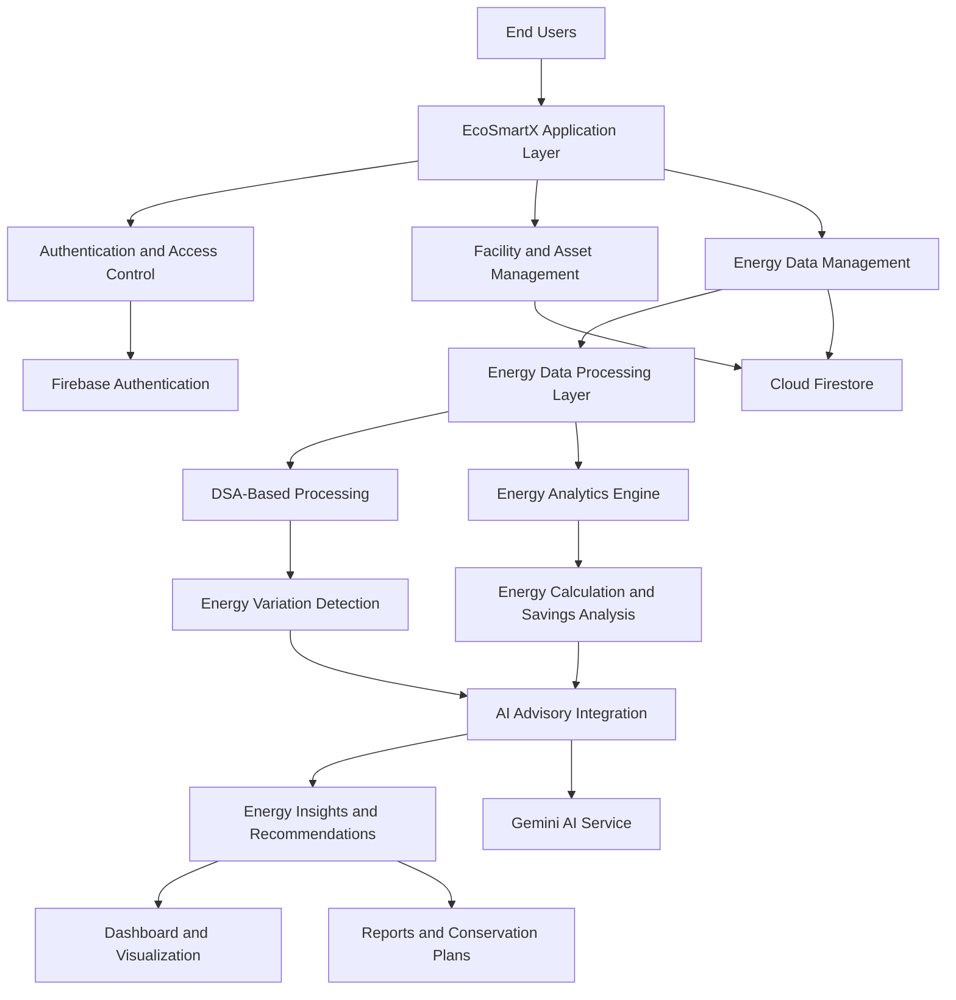

# EcoSmartX – Global Intelligent Energy and Sustainable Infrastructure Innovation Platform
**Energy Intelligence for a Greener Tomorrow**

---

## Table of Contents

- [1. Project Overview](#1-project-overview)
- [2. Problem Statement](#2-problem-statement)
- [3. Project Objectives](#3-project-objectives)
- [4. Sustainable Development Goals](#4-sustainable-development-goals)
- [5. Target Users and Applications](#5-target-users-and-applications)
- [6. System Features and Functional Modules](#6-system-features-and-functional-modules)
- [7. Data Structures and Algorithms](#7-data-structures-and-algorithms)
- [8. System Architecture](#8-system-architecture)
- [9. System Operational Workflow](#9-system-operational-workflow)
- [10. Potential System Integrations](#10-potential-system-integrations)
- [11. Project Significance](#11-project-significance)

---

## 1. Project Overview

**EcoSmartX** is an academic engineering project focused on applying Data Structures and Algorithms (DSA), artificial intelligence, and energy analytics to the domain of intelligent energy management and sustainable resource utilization.

The system is designed to facilitate the organization, processing, analysis, and interpretation of electrical energy consumption data. It aims to identify consumption patterns, detect anomalous variations, evaluate potential energy inefficiencies, and generate data-driven recommendations for energy optimization.

EcoSmartX extends conventional energy monitoring by incorporating analytical capabilities that help translate raw consumption records into actionable energy intelligence.

The project demonstrates the practical application of computational techniques and software engineering principles to an energy-management problem, with particular emphasis on energy efficiency, consumption optimization, and environmental sustainability.

## 2. Problem Statement

Electrical energy consumption across residential, commercial, industrial, and institutional environments generates substantial operational data. However, the availability of consumption data alone does not necessarily provide sufficient insight into energy utilization or operational efficiency.

The absence of effective data analysis and interpretation can create several challenges:

- Insufficient visibility into temporal energy consumption patterns.
- Limited identification of abnormal consumption behaviour.
- Difficulty correlating energy variations with appliance or equipment operation.
- Inadequate identification of potential energy wastage.
- Limited analytical support for energy optimization decisions.
- Difficulty quantifying potential energy and financial savings.
- Insufficient awareness of the environmental impact associated with electricity consumption.

EcoSmartX addresses these challenges through a unified software-based approach involving energy data management, computational analysis, variation detection, AI-assisted interpretation, and optimization-oriented recommendations.

**Core engineering objective:** Transform structured energy consumption data into interpretable analytical information that supports informed energy-management decisions.

## 3. Project Objectives

The principal technical and sustainability objectives are:

1. Apply fundamental Data Structures and Algorithms to an energy-management application.
2. Establish an organized approach to energy consumption data representation and processing.
3. Analyse energy consumption trends across defined measurement intervals.
4. Identify abnormal consumption variations and potential operational inefficiencies.
5. Support appliance-level and facility-level energy analysis.
6. Incorporate AI-assisted interpretation and recommendation capabilities.
7. Estimate energy consumption, electricity expenditure, potential savings, and associated carbon emissions.
8. Provide analytical support for energy conservation and optimization.
9. Demonstrate the relationship between computational problem-solving and sustainable engineering practices.

## 4. Sustainable Development Goals

EcoSmartX is conceptually aligned with three United Nations Sustainable Development Goals.

### SDG 7 — Affordable and Clean Energy

**Ensure access to affordable, reliable, sustainable and modern energy for all.**

The project supports energy-efficiency awareness through structured consumption analysis, identification of potential inefficiencies, and exploration of electricity conservation opportunities.

### SDG 12 — Responsible Consumption and Production

**Ensure sustainable consumption and production patterns.**

The system promotes responsible resource utilization by helping users evaluate consumption behaviour, identify potential energy wastage, and make data-informed decisions regarding electricity usage.

### SDG 13 — Climate Action

**Take urgent action to combat climate change and its impacts.**

EcoSmartX incorporates environmental impact awareness through estimated electricity-related carbon emissions and energy conservation analysis.

The project illustrates how computational analysis and intelligent information systems can contribute to sustainability-oriented decision-making.

## 5. Target Users and Applications

The system addresses energy-management requirements across multiple operational environments.

| Application Domain | Engineering and Operational Relevance |
|---|---|
| Residential Buildings | Household load analysis, appliance consumption assessment, and electricity expenditure optimization. |
| Commercial Infrastructure | Building-level consumption analysis and identification of potential operational inefficiencies. |
| Industrial Facilities | Equipment-related energy analysis and investigation of abnormal consumption patterns. |
| Educational Campuses | Institutional energy monitoring and structured energy conservation initiatives. |
| Facility Management | Facility and asset information organization with consumption-based operational assessment. |
| Energy Management | Energy performance evaluation and identification of optimization opportunities. |
| Sustainability Management | Electricity-related environmental impact assessment and conservation planning. |

## 6. System Features and Functional Modules

### 6.1 Energy Monitoring Dashboard

Provides a consolidated visualization layer for energy-related performance indicators, including consumption records, electricity expenditure, historical trends, and relevant analytical metrics.

### 6.2 Facility Management

Implements facility-oriented information organization to support the classification and management of energy-related records across different locations.

### 6.3 Appliance and Asset Management

Maintains appliance and equipment attributes required for energy estimation, asset classification, and consumption analysis.

### 6.4 AI-Based Energy Advisory System

Integrates AI-assisted interpretation to process energy-related queries and provide contextual recommendations for improving energy efficiency.

### 6.5 Energy Analytics Engine

Supports the examination of energy consumption datasets through temporal comparison, trend analysis, consumption aggregation, and analytical visualization.

### 6.6 Energy Variation and Anomaly Intelligence

Provides analytical capabilities for identifying deviations from reference consumption patterns.

Potential variation categories include:

- Sudden consumption spikes.
- Gradual increases in energy demand.
- Periodic and cyclic consumption behaviour.
- Baseline and idle-load deviations.
- Seasonal consumption variations.
- Potential equipment-related inefficiencies.

The analytical objective is to identify deviations and support investigation of their possible causes.

Actual root-cause attribution requires sufficient supporting information, such as equipment-level measurements, operating schedules, occupancy data, or production records. Without such evidence, identified causes should be treated as potential explanations rather than confirmed diagnoses.

### 6.7 Energy Savings Simulation

Provides a scenario-based analytical approach for estimating potential energy and financial savings under alternative consumption conditions.

### 6.8 Energy Conservation Planning

Organizes optimization recommendations into actionable energy conservation measures.

### 6.9 Carbon Emission Assessment

Estimates electricity-related greenhouse gas emissions using an appropriate grid emission factor and defined reporting period.

### 6.10 Reporting and Data Management

Supports the organization, retrieval, and presentation of energy-related information for analytical review and decision support.

## 7. Data Structures and Algorithms

A central academic component of EcoSmartX is the application of Data Structures and Algorithms to energy data organization, retrieval, and computational analysis.

The following table identifies relevant computational concepts and their potential roles within the system. The actual implementation should be validated against the source code.

| Data Structure / Algorithm | Technical Application |
|---|---|
| Arrays | Sequential representation and indexed processing of energy readings. |
| Lists | Dynamic organization of appliances, assets, and consumption records. |
| Hash Maps | Key-based retrieval and association of facility, asset, and energy records. |
| Linear Search | Sequential lookup of records within collections. |
| Binary Search | Efficient lookup within appropriately sorted datasets. |
| Sorting Algorithms | Ordering energy readings, appliances, and consumption values for comparative analysis. |
| Stacks | Last-in-first-out processing for operations that require reverse-order access. |
| Queues | First-in-first-out processing of ordered data or pending operations. |
| Trees | Hierarchical representation of facility, building, and asset relationships where applicable. |
| Graphs | Representation of interconnected energy assets and system relationships where applicable. |
| Statistical Algorithms | Computation of consumption summaries, deviations, and trend indicators. |
| Time-Series Processing | Chronological analysis of energy readings and temporal consumption behaviour. |

### Computational Relevance

The selection of appropriate data structures and algorithms affects the computational efficiency, retrieval performance, and scalability of data-processing operations.

For example:

- Indexed collections support sequential reading and aggregation.
- Hash-based structures support key-oriented record access.
- Searching algorithms facilitate record retrieval.
- Sorting algorithms support ordered comparison and ranking.
- Statistical operations support consumption analysis and anomaly investigation.

These computational techniques establish the DSA foundation for applying algorithmic problem-solving to energy-management data.

### Algorithmic Complexity

The following are standard theoretical complexity characteristics, not measured performance results from EcoSmartX.

| Operation | Representative Complexity |
|---|---|
| Array index access | \(O(1)\) |
| Linear search | \(O(n)\) |
| Binary search on sorted data | \(O(\log n)\) |
| Hash table lookup | \(O(1)\) average case |
| Comparison-based sorting | \(O(n\log n)\) for efficient algorithms |
| Stack insertion and deletion | \(O(1)\) |
| Queue insertion and deletion | \(O(1)\) with an appropriate implementation |

Here, \(n\) represents the number of elements in the processed dataset.

## 8. System Architecture

The following conceptual architecture illustrates the logical relationship between the application interface, authentication, energy data management, analytical processing, and AI-assisted recommendation components.

### Architectural Components

| Layer | Responsibility |
|---|---|
| Application Layer | User interaction, navigation, and presentation of energy information. |
| Authentication Layer | User authentication and access control. |
| Facility and Asset Layer | Facility registration, asset organization, and related information management. |
| Data Management Layer | Storage, retrieval, and organization of energy-related records. |
| Processing Layer | Data preparation, aggregation, searching, sorting, and other computational operations. |
| Analytics Layer | Consumption analysis, variation assessment, and energy calculations. |
| AI Integration Layer | AI-assisted interpretation and generation of contextual recommendations. |
| Presentation Layer | Visualization of analytical results, reports, and conservation actions. |

*Architecture classification: conceptual logical architecture. Actual implementation boundaries, service communication, and data flows must be verified against the application source code.*

## 9. System Operational Workflow

EcoSmartX follows a structured analytical workflow:

**Data Acquisition → Data Processing → Anomaly Detection → Analytical Interpretation → Optimization Recommendations → Performance Evaluation**

1. **Data Acquisition:** Collect or register available energy consumption information.
2. **Data Processing:** Organize, validate, and process energy records.
3. **Anomaly Detection:** Identify unusual consumption variations and deviations from reference patterns.
4. **Analytical Interpretation:** Examine consumption behaviour and investigate potential contributing factors.
5. **Optimization Recommendations:** Generate relevant energy conservation suggestions.
6. **Performance Evaluation:** Compare consumption before and after an intervention to assess potential improvements.

This workflow connects computational data processing with energy-performance evaluation and sustainability-oriented decision-making.

## 10. Potential System Integrations

EcoSmartX has the potential to expand into a connected energy-management ecosystem through integration with external electrical, industrial, and IoT infrastructure.

| Integration Technology | Potential Engineering Application |
|---|---|
| Smart Energy Meters | Automated acquisition of electrical consumption measurements. |
| IoT Sensor Networks | Equipment telemetry and environmental parameter monitoring. |
| Solar PV Inverters | Monitoring photovoltaic generation and energy utilization. |
| Battery Management Systems | Monitoring battery state, charging, discharging, and storage utilization. |
| EV Charging Infrastructure | Analysis of electric vehicle charging demand and consumption. |
| Building Management Systems | Building automation and monitoring through BACnet-compatible systems. |
| Industrial Communication Protocols | Equipment data acquisition through Modbus and MQTT. |
| Weather Data Services | Correlation of environmental conditions with energy demand. |
| Advanced Predictive Analytics | Energy demand forecasting, anomaly prediction, and predictive maintenance. |

These integrations represent potential architectural extensions and are not assertions of existing connectivity.

## 11. Project Significance

EcoSmartX demonstrates the application of computer science and engineering principles to a practical energy-management challenge.

From a computational perspective, it provides an application domain for studying data representation, algorithmic processing, information retrieval, and analytical operations.

From an energy-management perspective, it explores how consumption data can support anomaly investigation, efficiency assessment, and energy conservation planning.

From a sustainability perspective, it promotes responsible electricity utilization and awareness of energy-related environmental impact.

The project therefore connects **algorithmic problem-solving, intelligent data analysis, electrical energy management, and sustainable development** within a unified academic application.

 
